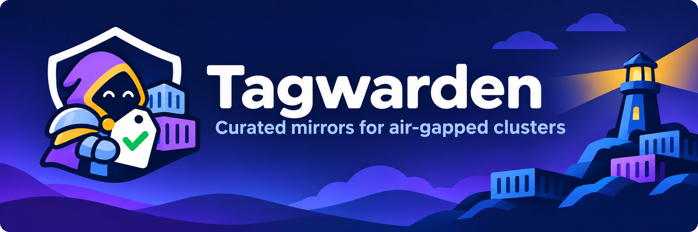
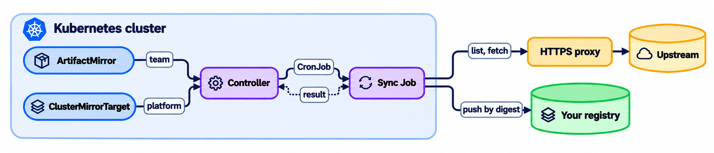
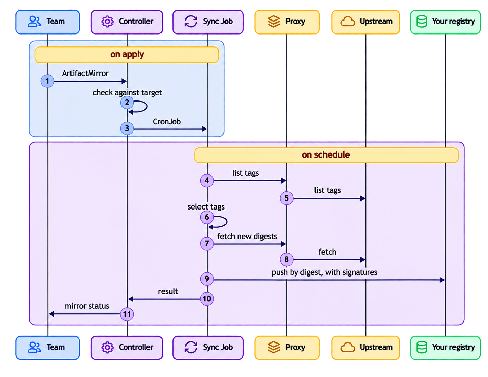
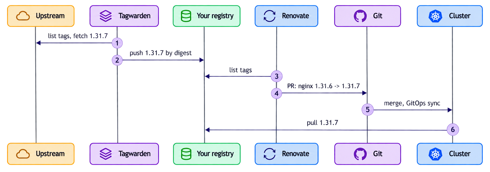

<p align="center"></p>

[](https://github.com/r-gawronski/tagwarden/actions/workflows/ci.yaml)
[](https://github.com/r-gawronski/tagwarden/actions/workflows/test-e2e.yaml)
[](LICENSE)
[](go.mod)

Tagwarden is a Kubernetes operator that keeps your own OCI registry
stocked with the container images and Helm charts you pick.

You write one small YAML resource per upstream source: which repository,
which tags, how often. Tagwarden copies those tags by digest into your
registry, signatures included, and keeps doing it on schedule.

It's made for clusters that can't pull from the internet directly. Maybe
all you have is an HTTPS proxy, and someone wants to know exactly which
images got in. Tagwarden handles both.

> **Status: alpha.** The API is `v1alpha1` and can still change. Images
> and OCI charts work today. Classic Helm repositories and signature
> verification come next.

## Why you might want it

Registry replication rules match tags with globs and copy everything
that matches. That's fine until you want "the last three 1.31 patch
releases" or "stable tags from 1.17 up, nothing else". And mirroring
everything isn't an option when upstream has thousands of tags, nightly
and rc builds, and several GB per image.

Pull-through caches fetch on first use, so they fail when the upstream or
the proxy is down, which is when you need them most. Upgrade bots like
Renovate don't help here either: they propose version bumps, but they
don't decide what ends up in your registry.

With Tagwarden, the list of allowed artifacts lives in Git next to the
rest of your cluster config. You review it in pull requests like any
other change.

## How it works

<p align="center"></p>

There are two resources:

- `ClusterMirrorTarget` belongs to the platform team. It names your
  registry, the push credentials, the proxy, which upstream registries
  are allowed, and which namespaces may push to which project.
- `ArtifactMirror` belongs to a team. It lives in their namespace and
  says what to mirror and when.

The controller checks each mirror against its target and turns it into a
CronJob in the operator namespace. On schedule, a sync Job lists the
upstream tags, picks the ones you asked for, copies new digests with
their signatures, and reports back. You see the result in the mirror's
status.

### What happens during a sync run

<p align="center"></p>

## Examples

The platform team sets up the target once:

```yaml
apiVersion: mirror.tagwarden.dev/v1alpha1
kind: ClusterMirrorTarget
metadata:
  name: registry
spec:
  registry: registry.example.internal
  credentialsSecretRef: {name: registry-push}
  allowedSources: [registry.k8s.io, ghcr.io, quay.io, docker.io]
  projects:
    - name: mirror
      namespaceSelector: {}          # any namespace may push to "mirror"
  proxy:
    httpsProxy: http://proxy.example.internal:3128
    noProxy: [registry.example.internal]
    credentialsSecretRef: {name: proxy-credentials}
```

A team mirrors an image. This one keeps the three newest ingress-nginx
releases from 1.11.0 up, and only if they ship for both architectures:

```yaml
apiVersion: mirror.tagwarden.dev/v1alpha1
kind: ArtifactMirror
metadata:
  name: ingress-nginx
  namespace: team-net
spec:
  targetRef: registry
  schedule: "0 3 * * *"
  source: {registry: registry.k8s.io, repository: ingress-nginx/controller}
  target: {project: mirror}
  tags:
    include: ['^v\d+\.\d+\.\d+$']
    semverRange: ">=1.11.0"
    keepLatest: 3
  requiredPlatforms: [linux/amd64, linux/arm64]
```

Helm charts stored in an OCI registry work the same way. Set
`type: HelmOCI`:

```yaml
apiVersion: mirror.tagwarden.dev/v1alpha1
kind: ArtifactMirror
metadata:
  name: kube-prometheus-stack
  namespace: team-obs
spec:
  targetRef: registry
  schedule: "@daily"
  type: HelmOCI
  source: {registry: ghcr.io, repository: prometheus-community/charts/kube-prometheus-stack}
  target: {project: mirror}
  tags:
    semverRange: ">=75.0.0"
    keepLatest: 5
```

Artifacts land at `<registry>/<project>/<source registry>/<source
repository>`, for example
`registry.example.internal/mirror/registry.k8s.io/ingress-nginx/controller:v1.11.3`.
Set `target.repository` to pick a different path. That works only in
projects with `allowRepositoryOverride: true`, so a team cannot take over
the path of another source in a shared project. Enable it only for a
project owned by a single team, for example:

```yaml
  projects:
    - name: mirror
      namespaceSelector: {}          # shared: default paths only
    - name: team-net
      namespaceSelector:
        matchLabels: {example.com/team: net}
      allowRepositoryOverride: true  # one team picks its own paths
```

### Limits

One team shouldn't be able to hog a shared target. Every target has
limits, and you get the defaults without writing anything: schedules at
most hourly, 50 mirrors per namespace, `keepLatest` up to 20 and 50
explicit tags. Artifact size has no cap until you set one.

Go over a limit and your mirror gets `Ready=False` with reason
`ScheduleTooFrequent` or `LimitExceeded`, and Tagwarden removes its
CronJob. With too many mirrors in a namespace, the oldest keep running.
An artifact over `maxArtifactSize` fails in the sync run: Tagwarden
copies none of it and moves on to the other tags. Signatures, SBOMs and
other referrers get their own budget of the same size; if they go over
it, the tag fails and stays where it was. A layer shared by several
platforms of an index counts once per platform, so the check errs on the
strict side.

```yaml
spec:
  limits:
    minSyncInterval: 6h          # 5m at the lowest
    maxMirrorsPerNamespace: 20
    maxKeepLatest: 10            # up to 100
    maxExplicitTags: 20          # up to 100
    maxArtifactSize: 5Gi         # config plus layers, all platforms
```

### Sync now

Need a sync before the next scheduled run? Set the
`tagwarden.dev/sync-now` annotation to a new value. `patch` on your own
mirror is all it takes:

```sh
kubectl -n team-a annotate artifactmirror ingress-nginx --overwrite \
  tagwarden.dev/sync-now="$(date -u +%Y-%m-%dT%H:%M:%SZ)"
```

The request waits while a sync of the mirror runs and until the target's
`minSyncInterval` has passed since the last one started.
`status.lastSyncRequest` says whether it started, waits or was refused.
For a **Sync now** button and health checks in Argo CD, see
[docs/argocd.md](docs/argocd.md).

## Use cases

### Upgrades with Renovate

Your cluster can't see upstream registries, but you still want upgrade
PRs. Let Tagwarden keep a window of versions in your registry, point
your manifests at the mirrored path, and run Renovate against your
registry only. When a new release lands in the mirror, Renovate opens a
PR. After the merge, GitOps rolls it out and the image is already
there. Renovate can only ever propose a version that came in through
Tagwarden, and your registry holds only the window you picked.

<p align="center"></p>

The mirror keeps the three newest nginx releases from 1.30 up:

```yaml
apiVersion: mirror.tagwarden.dev/v1alpha1
kind: ArtifactMirror
metadata:
  name: nginx
  namespace: team-web
spec:
  targetRef: registry
  schedule: "0 * * * *"
  source: {registry: docker.io, repository: library/nginx}
  target: {project: mirror}
  tags:
    include: ['^\d+\.\d+\.\d+$']
    semverRange: ">=1.30.0"
    keepLatest: 3
```

Your manifests use the mirrored image:

```yaml
image: registry.example.internal/mirror/docker.io/library/nginx:1.31.7
```

Renovate gets read access to your registry. With a self-hosted
Renovate, keep the credentials in its own config and the token in an
environment variable:

```js
// config.js
module.exports = {
  secrets: {
    REGISTRY_TOKEN: process.env.REGISTRY_TOKEN,
  },
  hostRules: [
    {
      hostType: 'docker',
      matchHost: 'registry.example.internal',
      username: 'renovate',
      password: '{{ secrets.REGISTRY_TOKEN }}',
    },
  ],
};
```

And the repository config groups the mirrored images and automerges
patch releases:

```json
{
  "packageRules": [
    {
      "matchDatasources": ["docker"],
      "matchPackageNames": ["registry.example.internal/mirror/**"],
      "groupName": "mirrored images"
    },
    {
      "matchDatasources": ["docker"],
      "matchPackageNames": ["registry.example.internal/mirror/**"],
      "matchUpdateTypes": ["patch"],
      "automerge": true
    }
  ]
}
```

### Bootstrapping an air-gapped cluster

A fresh cluster needs its platform pieces before anything else works:
cert-manager, an ingress controller, a CSI driver. Mirror both the
images and the OCI charts, and your GitOps tool installs everything
from your registry on day one. Each image is its own mirror, so
cert-manager's controller, webhook and cainjector each get one.

```yaml
spec:
  source: {registry: quay.io, repository: jetstack/cert-manager-controller}
  target: {project: mirror}
  tags:
    semverRange: ">=1.18.0"
    keepLatest: 2
  requiredPlatforms: [linux/amd64, linux/arm64]
---
spec:
  type: HelmOCI
  source: {registry: quay.io, repository: jetstack/charts/cert-manager}
  target: {project: mirror}
  tags:
    semverRange: ">=1.18.0"
    keepLatest: 2
```

The chart's default image references still point upstream, so set its
image repositories to the mirrored paths in your values.

### Staying under Docker Hub pull limits

Fifty nodes pulling the same image from Docker Hub count as fifty pulls.
With Tagwarden, the image comes from Docker Hub once and every node
pulls it from your registry. Tags you already have aren't downloaded
again: Tagwarden checks them with HEAD requests, which Docker Hub
doesn't count as pulls, so an hourly schedule barely touches your
quota.

```yaml
spec:
  schedule: "0 * * * *"
  source: {registry: docker.io, repository: library/postgres}
  target: {project: mirror}
  tags:
    include: ['^\d+\.\d+$']
    semverRange: ">=17.0"
    keepLatest: 2
```

### One source, a window per team

Two teams use the same upstream but move at different speeds. Each
writes its own mirror of the same source into the same project. Both
mirrors land in the same target repository, so the registry holds the
union of both windows. Mirrors of different sources can't share a
path, so nobody can slip another image in under that name.

```yaml
# team-a stays on 2.13
spec:
  source: {registry: registry.k8s.io, repository: kube-state-metrics/kube-state-metrics}
  target: {project: mirror}
  tags: {semverRange: ">=2.13.0 <2.14.0", keepLatest: 2}
---
# team-b follows the newest releases
spec:
  source: {registry: registry.k8s.io, repository: kube-state-metrics/kube-state-metrics}
  target: {project: mirror}
  tags: {semverRange: ">=2.15.0", keepLatest: 3}
```

The project's `namespaceSelector` has to match both teams' namespaces.

## Features

- **Tag selection:** include and exclude regexes, semver ranges, keep
  latest N, and a list of exact tags. Regexes use RE2, so a bad pattern
  can't hang the sync. Plain numbers like `7` or `20240101` don't count
  as versions.
- **Digest first:** each tag gets resolved once and copied by digest.
  Tagwarden copies whole multi-arch indexes, so digests and signatures
  stay valid.
- **Signatures and attestations:** OCI referrers and cosign `.sig`,
  `.att` and `.sbom` tags come along with the image. If upstream signs
  later, the next run picks the signature up.
- **Proxy-only egress:** an HTTPS proxy with credentials and its own CA
  (for TLS-inspecting proxies), plus `noProxy`. mTLS and a private CA for
  your registry.
- **Moving tags:** when an upstream tag points to a new digest, the
  target decides: `Fail` (default), `Overwrite` or `Ignore`.
- **Multi-tenancy:** teams can only push to projects the platform team
  opened for their namespace, and only from allowed registries. Two
  mirrors can't write different sources to the same path. Per-target
  [limits](#limits) cap schedules, mirrors, tags and artifact size.
- **Locked-down sync Jobs:** they run only in the operator namespace,
  get no ServiceAccount token, and run distroless, non-root and
  read-only with all capabilities dropped. They refuse source hosts and
  redirects that point at internal, metadata or cluster addresses.
- **Least privilege:** the controller reads Secrets only in its own
  namespace.
- **Audit trail:** one JSON line per artifact (source digest, target,
  action, referrers), plus status conditions and Events.

## Quick start

You need Kubernetes 1.30 or newer and a registry you can push to.

1. Install the operator. Set `deniedCIDRs` to your pod and service
   CIDRs. More options are in [docs/install.md](docs/install.md).

   ```sh
   helm install tagwarden oci://ghcr.io/r-gawronski/charts/tagwarden \
     --version <version> \
     --namespace tagwarden-system --create-namespace \
     --set 'deniedCIDRs={10.244.0.0/16,10.96.0.0/12}'
   ```

   The first release is v0.1.0. Until it's out, install from source as
   described in [docs/install.md](docs/install.md).

2. Give the operator a push credential for your registry:

   ```sh
   kubectl -n tagwarden-system create secret docker-registry registry-push \
     --docker-server=registry.example.internal \
     --docker-username=<robot> --docker-password=<token>
   ```

3. Apply a `ClusterMirrorTarget` and an `ArtifactMirror` like the ones in
   [Examples](#examples). Leave out `proxy` if you have direct access.

4. Check how it went:

   ```sh
   kubectl get artifactmirrors -A
   kubectl -n team-net get artifactmirror ingress-nginx -o jsonpath='{.status.synced}'
   ```

   Don't want to wait for the schedule? See [Sync now](#sync-now).

## Documentation

- [Install](docs/install.md): Helm, Kustomize, uninstall.
- [Network policies](docs/network-policies.md): sync pod labels and
  example egress policies.
- [Argo CD](docs/argocd.md): a Sync now button and health checks.
- [Threat model](docs/threat-model.md): what Tagwarden trusts, and how it
  handles each threat.
- [Helm chart design](docs/design/helm-chart.md) and
  [spike results](docs/design/spikes.md).

## Contributing

Contributions are welcome. Have a look at
[CONTRIBUTING.md](CONTRIBUTING.md) first: commits need a DCO sign-off,
and changes come with tests. `make help` lists the build targets.

## Security

Found a vulnerability? Please report it privately, as described in
[SECURITY.md](SECURITY.md), not in a public issue.

## License

Apache License 2.0. See [LICENSE](LICENSE).
