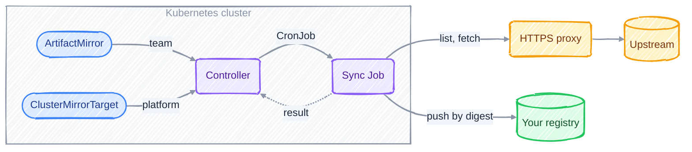
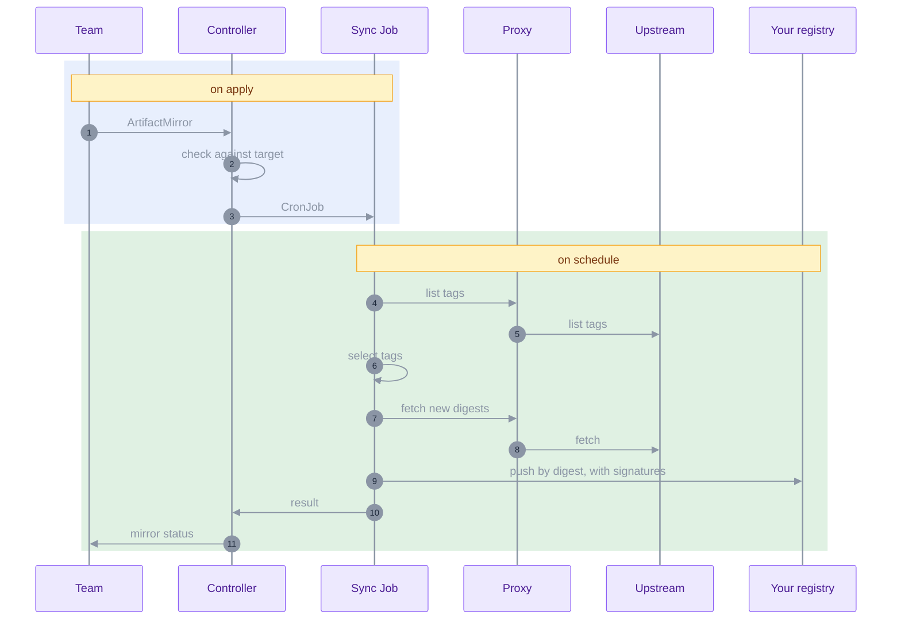

# Tagwarden

[](https://github.com/r-gawronski/tagwarden/actions/workflows/ci.yaml)
[](https://github.com/r-gawronski/tagwarden/actions/workflows/test-e2e.yaml)
[](LICENSE)
[](go.mod)

Tagwarden is a Kubernetes operator that keeps your own OCI registry
stocked with the container images and Helm charts you pick.

You write one small YAML resource per upstream source: which repository,
which tags, how often. Tagwarden copies those tags by digest into your
registry, signatures included, and keeps doing it on schedule.

It's made for clusters that can't pull from the internet directly. Maybe
all you have is an HTTPS proxy, and someone wants to know exactly which
images got in. Tagwarden handles both.

> **Status: alpha.** The API is `v1alpha1` and can still change. Images
> and OCI charts work today. Classic Helm repositories and signature
> verification come next.

## Why you might want it

Registry replication rules match tags with globs and copy everything
that matches. That's fine until you want "the last three 1.31 patch
releases" or "stable tags from 1.17 up, nothing else". Pull-through
caches fetch on first use, so they fail when the upstream or the proxy is
down, which is when you need them most.

With Tagwarden, the list of allowed artifacts lives in Git next to the
rest of your cluster config. You review it in pull requests like any
other change.

## How it works



There are two resources:

- `ClusterMirrorTarget` belongs to the platform team. It names your
  registry, the push credentials, the proxy, which upstream registries
  are allowed, and which namespaces may push to which project.
- `ArtifactMirror` belongs to a team. It lives in their namespace and
  says what to mirror and when.

The controller checks each mirror against its target and turns it into a
CronJob in the operator namespace. On schedule, a sync Job lists the
upstream tags, picks the ones you asked for, copies new digests with
their signatures, and reports back. You see the result in the mirror's
status.

### What happens during a sync run



## Examples

The platform team sets up the target once:

```yaml
apiVersion: mirror.tagwarden.dev/v1alpha1
kind: ClusterMirrorTarget
metadata:
  name: registry
spec:
  registry: registry.example.internal
  credentialsSecretRef: {name: registry-push}
  allowedSources: [registry.k8s.io, ghcr.io, quay.io, docker.io]
  projects:
    - name: mirror
      namespaceSelector: {}          # any namespace may push to "mirror"
  proxy:
    httpsProxy: http://proxy.example.internal:3128
    noProxy: [registry.example.internal]
    credentialsSecretRef: {name: proxy-credentials}
```

A team mirrors an image. This one keeps the three newest ingress-nginx
releases from 1.11.0 up, and only if they ship for both architectures:

```yaml
apiVersion: mirror.tagwarden.dev/v1alpha1
kind: ArtifactMirror
metadata:
  name: ingress-nginx
  namespace: team-net
spec:
  targetRef: registry
  schedule: "0 3 * * *"
  source: {registry: registry.k8s.io, repository: ingress-nginx/controller}
  target: {project: mirror}
  tags:
    include: ['^v\d+\.\d+\.\d+$']
    semverRange: ">=1.11.0"
    keepLatest: 3
  requiredPlatforms: [linux/amd64, linux/arm64]
```

Helm charts stored in an OCI registry work the same way. Set
`type: HelmOCI`:

```yaml
apiVersion: mirror.tagwarden.dev/v1alpha1
kind: ArtifactMirror
metadata:
  name: kube-prometheus-stack
  namespace: team-obs
spec:
  targetRef: registry
  schedule: "@daily"
  type: HelmOCI
  source: {registry: ghcr.io, repository: prometheus-community/charts/kube-prometheus-stack}
  target: {project: mirror}
  tags:
    semverRange: ">=75.0.0"
    keepLatest: 5
```

Artifacts land at `<registry>/<project>/<source registry>/<source
repository>`, for example
`registry.example.internal/mirror/registry.k8s.io/ingress-nginx/controller:v1.11.3`.
Set `target.repository` to pick a different path.

## Features

- **Tag selection:** include and exclude regexes, semver ranges, keep
  latest N, and a list of exact tags. Regexes use RE2, so a bad pattern
  can't hang the sync. Plain numbers like `7` or `20240101` don't count
  as versions.
- **Digest first:** each tag gets resolved once and copied by digest.
  Tagwarden copies whole multi-arch indexes, so digests and signatures
  stay valid.
- **Signatures and attestations:** OCI referrers and cosign `.sig`,
  `.att` and `.sbom` tags come along with the image. If upstream signs
  later, the next run picks the signature up.
- **Proxy-only egress:** an HTTPS proxy with credentials and its own CA
  (for TLS-inspecting proxies), plus `noProxy`. mTLS and a private CA for
  your registry.
- **Moving tags:** when an upstream tag points to a new digest, the
  target decides: `Fail` (default), `Overwrite` or `Ignore`.
- **Multi-tenancy:** teams can only push to projects the platform team
  opened for their namespace, and only from allowed registries. Two
  mirrors can't write different sources to the same path.
- **Locked-down sync Jobs:** they run only in the operator namespace,
  get no ServiceAccount token, and run distroless, non-root and
  read-only with all capabilities dropped. They refuse source hosts and
  redirects that point at internal, metadata or cluster addresses.
- **Least privilege:** the controller reads Secrets only in its own
  namespace.
- **Audit trail:** one JSON line per artifact (source digest, target,
  action, referrers), plus status conditions and Events.

## Quick start

You need Kubernetes 1.30 or newer and a registry you can push to.

1. Install the operator. Set `deniedCIDRs` to your pod and service
   CIDRs. More options are in [docs/install.md](docs/install.md).

   ```sh
   helm install tagwarden oci://ghcr.io/r-gawronski/charts/tagwarden \
     --version <version> \
     --namespace tagwarden-system --create-namespace \
     --set 'deniedCIDRs={10.244.0.0/16,10.96.0.0/12}'
   ```

   The first release is v0.1.0. Until it's out, install from source as
   described in [docs/install.md](docs/install.md).

2. Give the operator a push credential for your registry:

   ```sh
   kubectl -n tagwarden-system create secret docker-registry registry-push \
     --docker-server=registry.example.internal \
     --docker-username=<robot> --docker-password=<token>
   ```

3. Apply a `ClusterMirrorTarget` and an `ArtifactMirror` like the ones in
   [Examples](#examples). Leave out `proxy` if you have direct access.

4. Check how it went:

   ```sh
   kubectl get artifactmirrors -A
   kubectl -n team-net get artifactmirror ingress-nginx -o jsonpath='{.status.synced}'
   ```

   Don't want to wait for the schedule? Create a Job from the mirror's
   CronJob. `kubectl -n tagwarden-system get cronjobs` lists them; each
   has a `tagwarden.dev/mirror-name` annotation.

## Documentation

- [Install](docs/install.md): Helm, Kustomize, uninstall.
- [Network policies](docs/network-policies.md): sync pod labels and
  example egress policies.
- [Threat model](docs/threat-model.md): what Tagwarden trusts, and how it
  handles each threat.
- [Helm chart design](docs/design/helm-chart.md) and
  [spike results](docs/design/spikes.md).

## Contributing

Contributions are welcome. Have a look at
[CONTRIBUTING.md](CONTRIBUTING.md) first: commits need a DCO sign-off,
and changes come with tests. `make help` lists the build targets.

## Security

Found a vulnerability? Please report it privately, as described in
[SECURITY.md](SECURITY.md), not in a public issue.

## License

Apache License 2.0. See [LICENSE](LICENSE).
